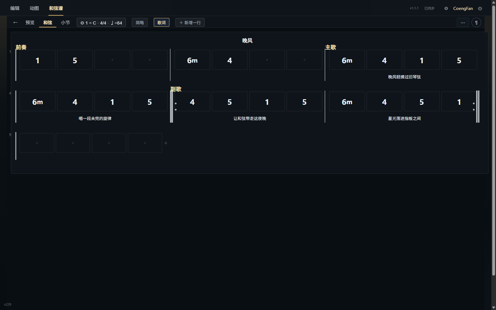
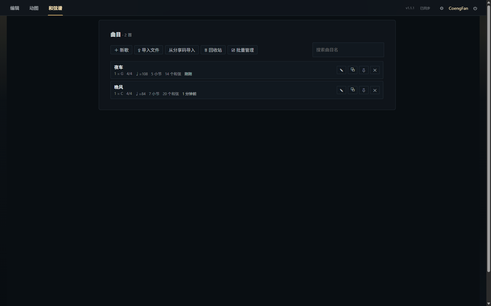
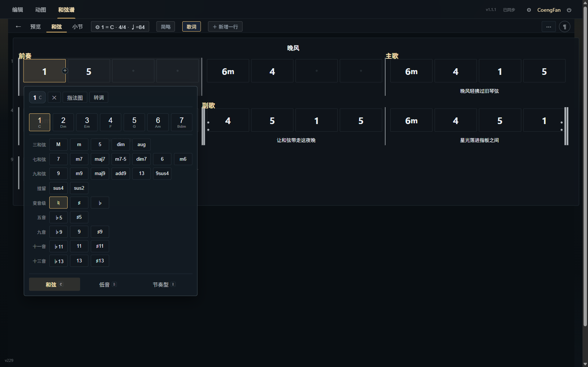
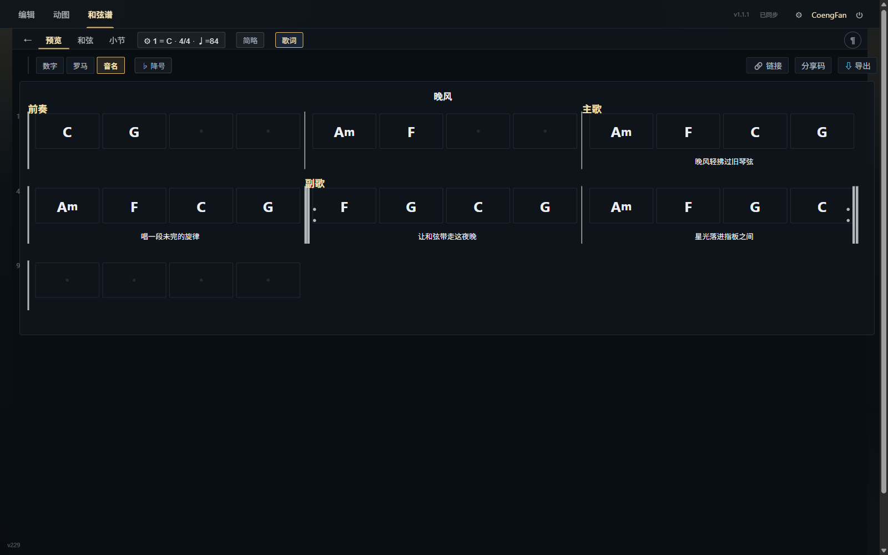
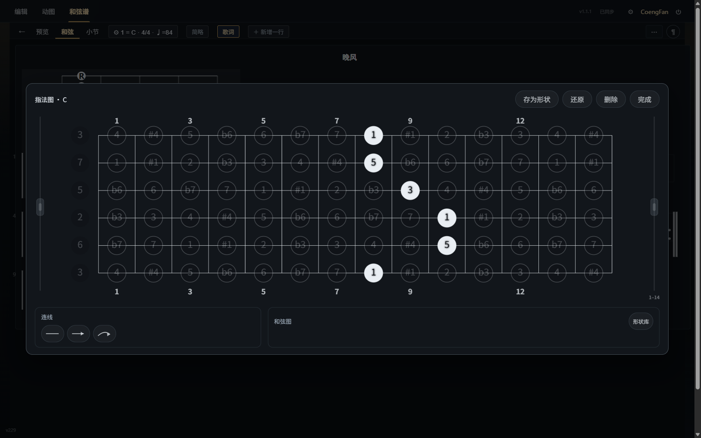
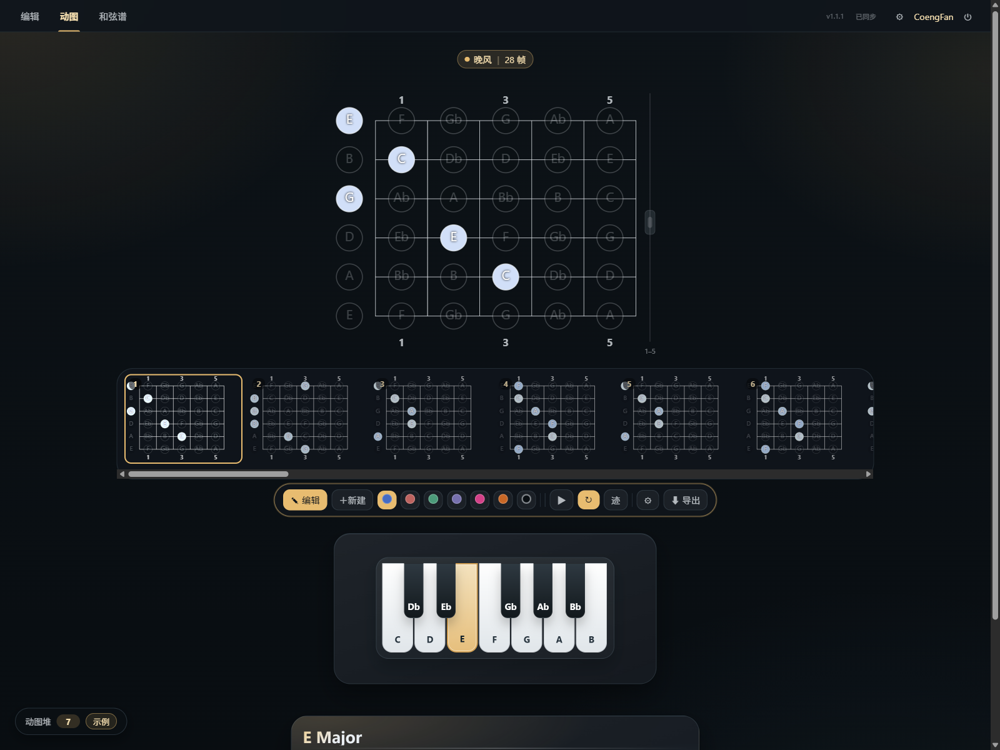
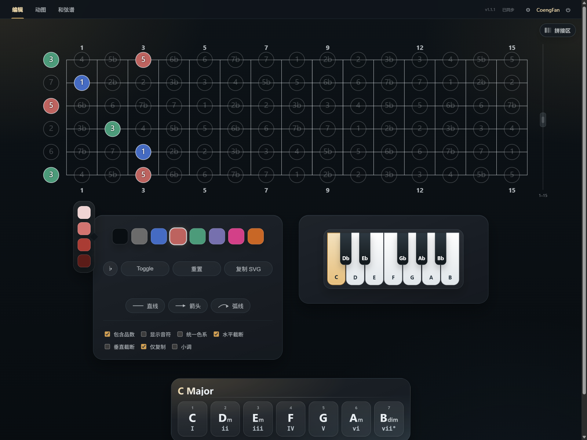
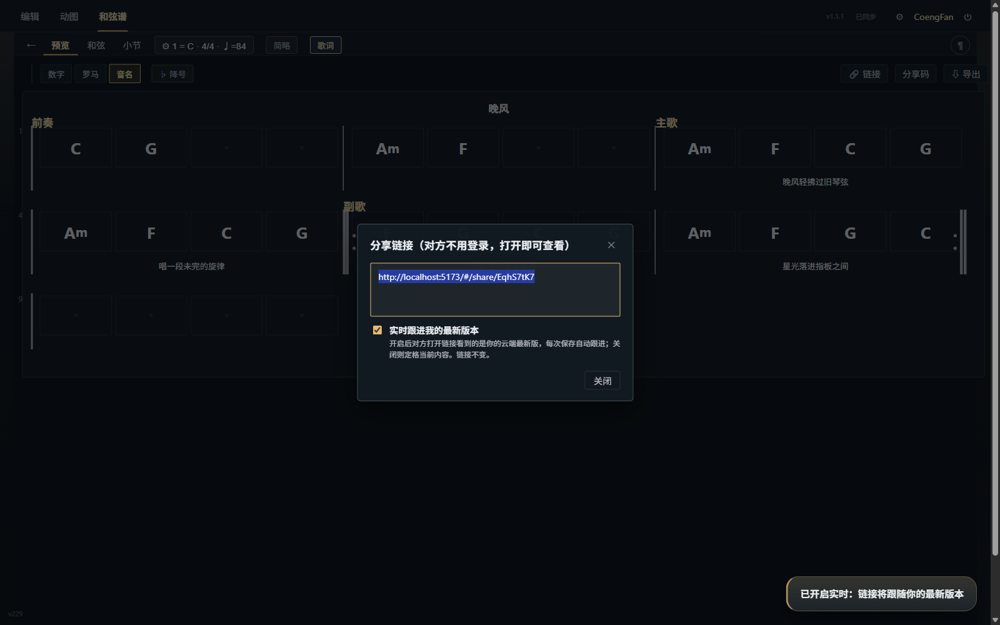

# 🥝 Fretboard Diagram Creator

<div align="center">

[](https://reactjs.org/)
[](https://vitejs.dev/)
[](LICENSE)

**[中文版](README.zh.md) | [English](README.md)**

**A modern web-based guitar fretboard and chord chart creator**: from interactive fretboard diagrams and complete song chord charts to animated technique playback — making guitar learning and music theory visualization clean, intuitive, and fun.



</div>

---

## ✨ Overview

Fretboard Diagram Creator is an interactive visualization tool tailored for guitarists, music educators, and learners. It combines three powerful modules:

- **Chord Charts**: Arrange complete song charts with Nashville numbers, Roman numerals, lyrics alignment, volta brackets, key changes, inline chord diagrams, and animated playback.
- **Clip Studio**: Create animated demonstrations for fretting-hand techniques (slides, hammer-ons, pull-offs, bends) and export them as high-quality GIF or WebM videos.
- **Fretboard Diagrams**: Freely craft individual fretboard diagrams featuring multi-color palettes, custom note connection curves, scale/triad inspectors, and crisp SVG/PNG export.

Engineered with a **local-first** approach: run everything offline in your browser with zero registration required. When you want multi-device synchronization, connect seamlessly to a self-hosted sync server (Node.js + SQLite).

---

## 🎵 Chord Charts

### Song Library

The library provides an organized view showing key, time signature, tempo (BPM), measure counts, and chord totals at a glance. Features song search, quick duplication, batch operations, and a built-in trash bin with a 10-day recovery window.



### Score Editing

- **Degree & Letter-Name Input**: Type keyboard numbers `1`–`7` to enter scale degrees directly (e.g., typing `1 m 7` generates `1m7`, `5 / 7` produces slash chord `5/7`), or hold `Shift` to enter letter-named chords (e.g., `Shift+A m` → `Am`).
- **Visual Chord Inspector**: Easily pick triads, 7ths, 9ths, suspended chords, alterations (♭9, ♯11, 13), slash bass notes, and rhythm patterns in a dedicated visual selector.
- **Rich Song Structure**: Mark song sections (Intro, Verse, Chorus, etc.), align lyrics with bold text styling, split off-beat beats, and assign measure background colors.
- **Repeats & Volta Brackets**: Configure multi-pass repeats and 1st/2nd ending brackets with synchronized notation rendering and audio playback according to standard music theory rules.
- **Flexible Transposition**: Change the key at any measure; subsequent chords transpose automatically while the header displays the active key in real time.
- **Full History**: Complete undo and redo support (`Ctrl+Z` / `Ctrl+Shift+Z`) for a stress-free editing experience.



### Flexible Notation Modes

Toggle instantly in preview mode between **Nashville Numbers (1–7)**, **Roman Numerals (I–vi)**, and **Standard Letter Chords (C–Am)**. Letter mode intelligently handles sharp/flat (♯/♭) spellings, saving your preferences with the song.



### Inline Fingering Diagrams & Shape Library

- **Measure-Level Chord Boxes**: Embed miniature chord boxes directly above chord beats in your score.
- **Interactive Fingering Editor**: Click on the fretboard to set voicings, draw barre arcs, and label specific fingerings.
- **Personal Shape Library**: Save customized voicings as shapes in your personal library to reuse them instantly across any song, fully synchronized across devices.



### One-Click Animation

Convert any finished chord chart into an animated clip with a single click. The tool slices keyframes on chord changes, highlights newly struck notes, and traces position shifts along the strings. The resulting clip can be further polished in Clip Studio.

---

## 🎬 Clip Studio

Bring guitar fretboard movements and techniques to life:

- **Technique Annotations**: Effortlessly mark slides (`sl`), hammer-ons and pull-offs (`h`/`p`), bends (`bd`), and hand position shifts between any two notes to generate smooth transitions automatically.
- **Smooth Playback & Visual Feedback**: WYSIWYG animation with moving light dots, expanding ripples, technique badges, and looping preview.
- **Clip Drawer**: Expand the drawer at the bottom-left to preview all saved clips on hover, switch active clips, or rename them with a double-click.
- **Multi-Format Export**: Export your animation as high-resolution GIF, WebM video, SMIL vector SVG, or JSON project files, with adjustable frame hold and transition timings.



---

## 🎸 Interactive Fretboard Diagrams

A flexible diagramming tool designed for music education, scale practice, and chord derivation:

- **Versatile Color System**: 6 core palettes (Navy, Crimson, Forest Green, Indigo, Soft Pink, Warm Brown) with light/dark variants and custom highlights. Use keyboard shortcuts (`B`/`G`/`R`/`W`/`D`) to switch colors instantly, and drag-select multiple notes for batch editing.
- **Note Connections**: Draw straight, curved, or arrow lines between notes. A floating menu lets you adjust line width, curvature, frosted glass styling, and colors.
- **Scale Inspector & Piano Keyboard**: Select any root note to instantly view natural major/minor scales and diatonic triads across the entire fretboard.
- **Display Customization**: Set visible fret ranges (1–22 frets), toggle ghost/unselected note opacity, switch between ♯/♭ accidentals, and display note names or scale degrees.
- **High-Definition Export & Stitching**: Export crisp SVG vectors or high-res PNGs with automatic whitespace trimming and one-click clipboard copying. Use the Stitching canvas to align multiple diagrams into a comprehensive tutorial graphic.



---

## 🔗 Sharing, Collaboration & Import

- **Seamless Sharing**:
  - **Cloud Short Links** (`#/share/<id>`): Signed-in users can generate read-only links that **anyone can open without an account** to view and play the chart.
  - **Live Sync Mode**: Enable "Follow my latest version" in the share dialog so viewers automatically receive updates whenever you save; turn it off to lock a permanent static snapshot.
  - **Self-Contained Offline Links**: Pack full song data directly into the URL, allowing zero-backend sharing over chat or email.
- **Compact Share Codes**: Generate a compressed text snippet of the full chart (including chord boxes and animations) that can be pasted anywhere to restore the song 100%.
- **Project Files (.fbchart)**: Export single songs or batch-export your library into `.fbchart` bundle files with all embedded media for safe offline backups.
- **Industry Standard Interchange**: Export and import standard **MusicXML** files to collaborate seamlessly with software like MuseScore, Guitar Pro, and Sibelius.



---

## 👤 Accounts & Cloud Sync

- **Local-First Architecture**: Changes are always saved to your local browser storage first and queued for background synchronization, safeguarding your work against connection drops.
- **Real-Time Device Sync**: Updates are pushed across signed-in devices via Server-Sent Events (SSE), keeping your computer, tablet, and phone in sync.
- **Conflict Protection**: Concurrent edits across devices trigger safe conflict copies rather than silently overwriting your work.
- **Frictionless Guest Experience**: Enjoy full functionality without logging in; when you decide to register, your local guest data merges seamlessly into your account.

For technical details on synchronization protocols (revisions, hashing, incremental fetches, and tombstones), check out [CLOUD_SYNC.md](CLOUD_SYNC.md).

---

## 📦 Installation & Deployment

### Requirements

- **Node.js**: 18 or higher
- **Package Manager**: pnpm (recommended) or npm

### Quick Start

```bash
git clone <repository-url>
cd fretboard-diagram

pnpm install

# Start the frontend development server (http://localhost:5173)
pnpm dev

# Start the optional sync service (http://127.0.0.1:8787; runs in local mode if omitted)
pnpm server

# Build for production
pnpm build
```

> [!TIP]
> The account sync service initializes its SQLite database automatically on first run. Configure admin credentials via `FRETB_USER` and `FRETB_PASS` environment variables; if not set, random credentials will be generated and saved to `server/credentials.txt`.

### Automated Testing

```bash
pnpm smoke:core                 # Animation kernel smoke tests
pnpm smoke:auth                 # Server sync end-to-end tests
node scripts/smoke-chords.mjs   # Chord chart domain tests
pnpm lint:css                   # CSS rules and styling lint
```

---

### 🐳 Docker Deployment

For containerized deployment, the production stack includes two core services: the **frontend static server** (Nginx serving production assets and reverse-proxying API endpoints, default port 1645) and the **auth service** (Node.js + SQLite sync server):

```bash
# Build and run the core services
docker compose up -d --build --no-deps fretboard-diagram auth

# Open http://localhost:1645 in your browser
```

> [!NOTE]
> Persistent data is stored in the `./server-data/` volume directory. Back up or transfer this directory to migrate all accounts and songs. Legacy backend/mongo containers defined in `docker-compose.yml` can be safely ignored or commented out.

---

## 📁 Project Structure

```
fretboard-diagram/
├── src/
│   ├── components/         # React UI components (charts, fretboards, clips, stitch, shapes, etc.)
│   ├── utils/              # Domain logic (chart model, clip rendering, sync engine, music theory, etc.)
│   ├── css/                # Modular stylesheets (imported through fretboard.css)
│   ├── i18n/               # Internationalization strings (en / zh)
│   ├── Fretboard.jsx       # Main interactive fretboard component (static & animated modes)
│   ├── main.jsx            # Application entry point
│   └── fretboard.css       # Style manifest
├── server/                 # Account & cloud sync service (Node.js + better-sqlite3)
│   ├── index.js
│   └── Dockerfile
├── scripts/                # Smoke tests, CSS linting, and sampling scripts
├── docs/screenshots/       # Documentation screenshots
├── server-data/            # SQLite persistent volume (Docker mounted, gitignored)
├── docker-compose.yml
├── nginx.conf              # Nginx config for static assets and /api reverse proxy
└── vite.config.js
```

## 📄 License

This project is licensed under the MIT License. See [LICENSE](LICENSE) for details.

**Original copyright:** Copyright (c) 2021 Tobias Kolditz

---

## 🙏 Acknowledgements

Inspired by the original [fretboard-diagram-creator](https://github.com/kldtz/fretboard-diagram-creator). Sincere thanks to [Tobias Kolditz](https://github.com/kldtz) for creating the initial foundation for guitar fretboard diagramming.

This project was rewritten from the ground up using React and modern web technologies, significantly expanding its scope with a full chord chart arranger, fretting animation tools, and multi-device cloud synchronization.

---

<div align="center">

**Code the music, visualize the theory** 🎵

</div>
