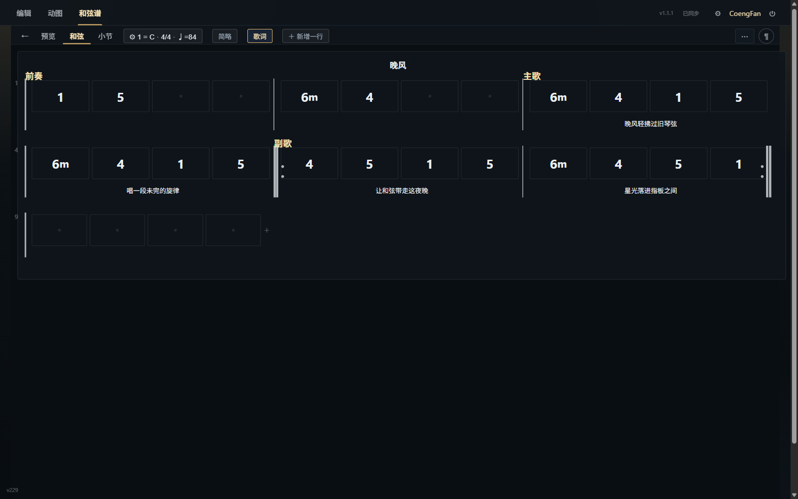
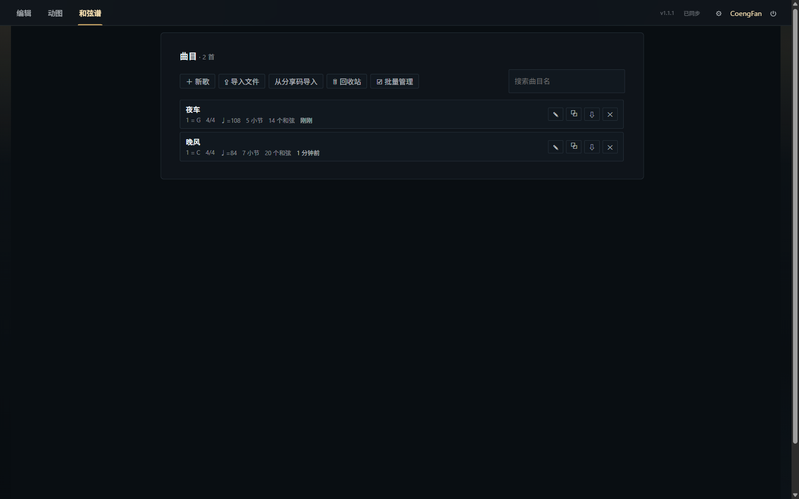
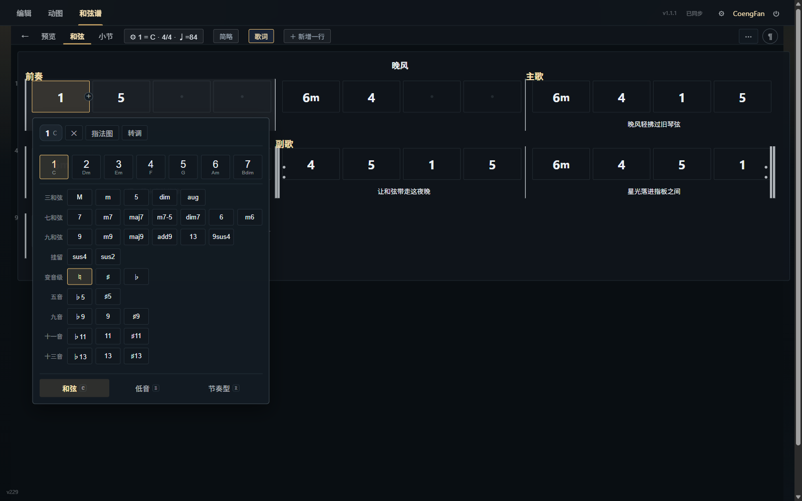
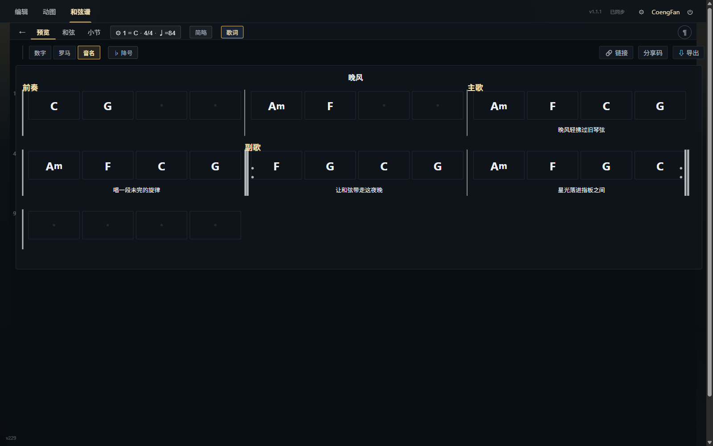
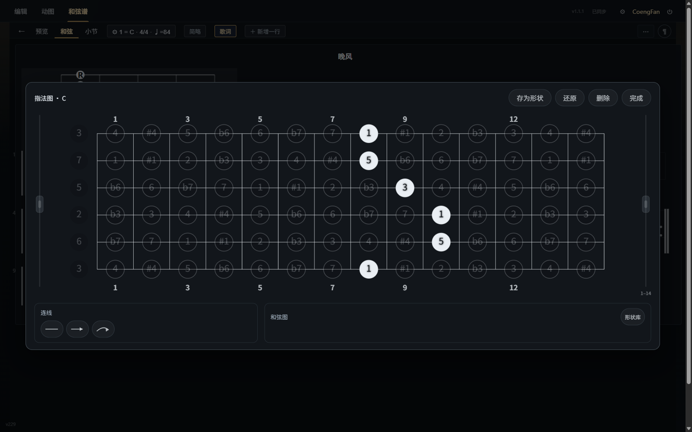
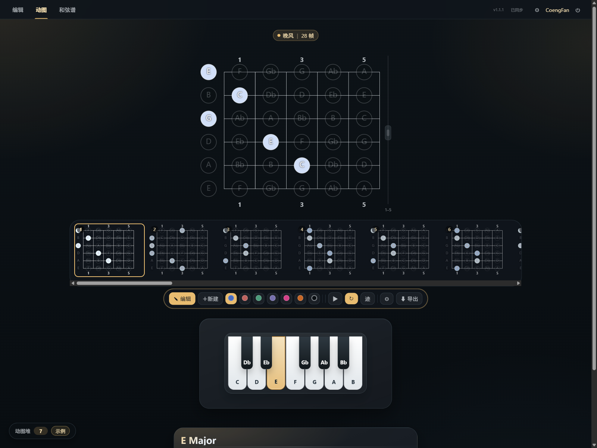
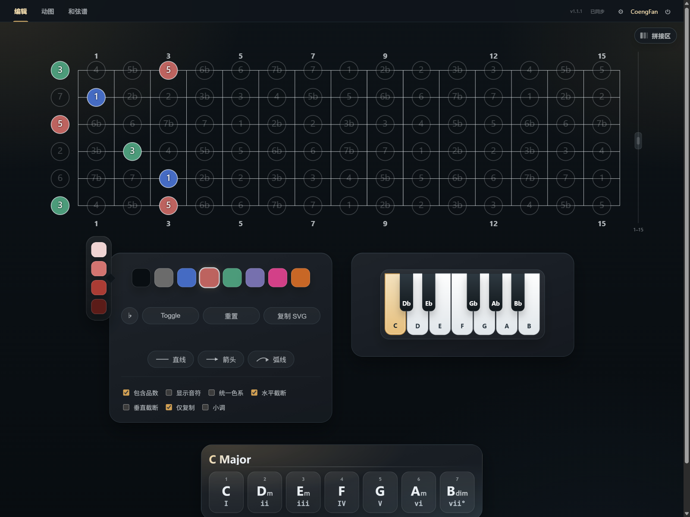
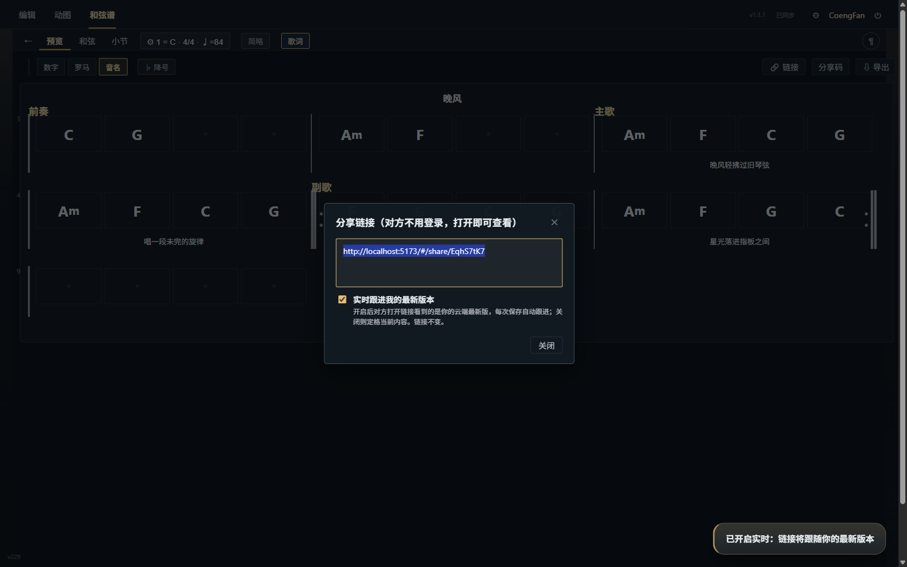

# 🥝 Fretboard Diagram Creator

<div align="center">

[](https://reactjs.org/)
[](https://vitejs.dev/)
[](LICENSE)

**[中文版](README.zh.md) | [English](README.md)**

**现代化吉他指板图与和弦谱创作工具**：从单张指板图绘制，到整首歌曲和弦谱编配，再到吉他演奏技巧的动效演示——让吉他学习与乐理可视化变得直观、优雅而有趣。



</div>

---

## ✨ 项目简介

Fretboard Diagram Creator 是专为吉他手、音乐教师和乐理学习者打造的可视化音乐创作工具，核心包含三大模块：

- **和弦谱编配（Chord Charts）**：以歌曲为单位进行整曲编配，支持级数输入、歌词排版、反复记号与房子、转调换算、内嵌指法图及一键生成演奏动图。
- **演奏动图（Clip Studio）**：制作手型与演奏技巧的动效演示，支持滑弦、击弦、勾弦、推弦等技法过渡，可导出高清 GIF 与 WebM 格式。
- **交互式指板图（Fretboard Diagrams）**：自由绘制单张吉他指板图，支持丰富配色体系、音符连线、内置音阶与和弦推导面板，支持一键导出矢量 SVG / PNG。

基于**本地优先（Local-First）**理念构建：无需注册，打开浏览器即可离线使用全部功能；支持自托管数据同步服务（Node + SQLite），多端数据实时云端互通。

---

## 🎵 和弦谱编配

### 曲库管理

曲目列表清晰展示调号、拍号、BPM、小节数与和弦数等核心信息，支持曲目检索、快速复制与批量管理；内置回收站保护机制，误删曲目 10 天内随时一键还原。



### 谱面编辑

- **级数与音名双模式输入**：直接按键盘 `1`–`7` 快速录入级数（如连续输入 `1 m 7` 生成 `1m7`、`5 / 7` 生成转位和弦 `5/7`），按住 `Shift` 即可直接录入音名和弦（如 `Shift+A m` 生成 `Am`）。
- **可视化和弦选择面板**：三和弦、七和弦、九和弦、挂留（sus）、变音级与高阶延伸音（♭9、♯11、13 等）、转位低音（Slash Chords）及节奏型一屏点选。
- **完整的歌曲结构表达**：支持段落标记（前奏/主歌/副歌等）、段落歌词对齐与文字高亮、反拍节奏拆分、休止与延音记号、小节背景色彩高亮。
- **标准反复与房子记号（Volta）**：支持设置多遍反复记号与 1/2 房子括号，排版渲染与试听播放完全符合标准乐理规则。
- **自由转调**：可在曲目任意小节插入调号变更，后续小节自动换算和弦级数，顶栏实时提示当前生效调号。
- **历史记录**：支持完整的撤销与重做操作（`Ctrl+Z` / `Ctrl+Shift+Z`），编配无负担。



### 多种记谱形式切换

预览模式下一键在**数字级数（1–7）**、**罗马数字（I–vi）**与**音名和弦（C–Am）**之间自由切换；音名模式下支持升降号（♯/♭）智能转换，随谱保存并跨端同步。



### 谱内指法图与形状库

- **小节内嵌指法**：可为小节内任意和弦拍位附加吉他指法盒式图（Chord Box），排版紧凑清晰。
- **可视化编辑**：在指板编辑板上直接点选按法、标注横按与滑弦连线、添加技巧说明。
- **常用形状库**：将精心编配的特色按法「保存为形状」，在同一曲目或其它曲目中遇到同名和弦即可一键复用。



### 和弦谱一键转动图

编配完成的和弦谱可一键转化为动态演示片段（Clip）：系统会按和弦切换时机自动切分关键帧、高亮新击发音符，并在同弦位移时智能识别滑弦轨迹，生成后可直接在动图模块中二次润色。

---

## 🎬 动态演示（Clip Studio）

用于直观呈现吉他演奏动作与把位变换过程：

- **吉他技法标注**：支持滑弦（`sl`）、击弦与勾弦（`h`/`p`）、推弦（`bd`）等经典技巧，选定起点与终点音符即可自动生成平滑过渡帧。
- **直观动效渲染**：所见即所得的帧间过渡效果，包含光点位移、渐变淡出、水波纹扩散与技法标识符，支持循环播放预览。
- **片段抽屉管理**：左下角展开片段列表，鼠标悬停即可即时预览动画效果，支持快捷切换编辑与重命名。
- **多格式高质量导出**：可导出为 GIF 动图、WebM 视频、SMIL 矢量 SVG 或 JSON 数据文件，每帧停留时长与过渡时间均可自由调整。



---

## 🎸 交互式指板图

专为乐理教学、音阶推导与把位记忆设计的高自由度指板绘图工具：

- **丰富色彩与标记**：内置 6 种主题色系（藏青、绯红、森林绿、蓝紫、粉红、暖棕）及明暗变体与自定义高亮，支持快捷键（`B`/`G`/`R`/`W`/`D`）快速选色，支持框选多个音符批量设置。
- **音符连线与标注**：支持拖拽绘制直线、箭头与弧线连接音符；点击连线可唤出浮动菜单调节粗细、弧度、毛玻璃背景与颜色。
- **乐理辅助与音阶面板**：内置虚拟钢琴键盘，选定任意根音即可自动展示自然大/小调音阶及各级顺阶三和弦，推导直观高效。
- **显示模式自由定制**：支持自由调节截取品位（1–22 品）、切换隐藏/弱化未选音符、升降号（♯/♭）拼写切换、音名与首调唱名（1 2 3...）自由切换。
- **高清导出与多板拼接**：支持导出无损矢量 SVG 与高清 PNG，自动智能裁切多余留白并支持一键复制到剪贴板；多张指板图可在拼接画布中横向拼合成完整教程长图。



---

## 🔗 分享、协作与导入

- **便捷分享链接**：
  - **云端短链**（`#/share/<id>`）：登录后一键生成短链接，对方**无需注册账号**，通过任意浏览器即可直接查看、播放并试听谱面。
  - **实时同步跟随**：在分享设置中开启「实时跟进我的最新版本」，对方页面会在你每次保存后自动接收更新；关闭开关则生成静态快照，链接内容永久固定。
  - **离线自包含链接**：将整谱数据直接压缩进 URL，无需服务器即可在社交平台或聊天工具中快速传递。
- **紧凑分享码**：将整首谱面（包含指法配图与演奏动图）打包为一串文本分享码，复制粘贴即可 100% 完整还原。
- **本地工程文件（.fbchart）**：支持将单首或多首曲目导出为 `.fbchart` 本地工程文件，包含所有内嵌素材，便于长久备份与跨设备迁移。
- **行业标准格式互通**：支持导出与导入通用 **MusicXML** 格式，方便与 MuseScore、Guitar Pro 等专业打谱软件互相导入导出。



---

## 👤 账户与数据同步

- **本地优先（Local-First）**：所有编辑操作均优先保存在本地浏览器中，即便网络断开或服务维护也不会丢失数据，连网后自动完成后台同步。
- **多设备实时推送**：多端登录同一账号时，基于 Server-Sent Events（SSE）实现毫秒级自动推送，电脑、平板与手机保持内容同步。
- **智能冲突保护**：若同一谱面在多台设备上发生并发修改，系统会自动识别冲突并另存为副本，绝不静默覆盖已有成果。
- **免登录游客体验**：无需注册即可体验全部核心功能；注册或登录后，本地游客数据可一键无缝合并至云端账号。

更多数据同步协议与实现细节（版本控制、增量拉取、脏检查机制等）请参阅 [CLOUD_SYNC.md](CLOUD_SYNC.md)。

---

## 📦 本地开发与部署

### 环境要求

- **Node.js**: 18 或更高版本
- **包管理器**: pnpm（推荐）或 npm

### 快速开始

```bash
git clone <repository-url>
cd fretboard-diagram

pnpm install

# 启动前端开发服务器（http://localhost:5173）
pnpm dev

# 启动同步服务（可选，默认运行在 http://127.0.0.1:8787；不启动则以纯本地模式运行）
pnpm server

# 构建前端生产包
pnpm build
```

> [!TIP]
> 账号同步服务在首次启动时会自动初始化 SQLite 数据库。管理员凭据可通过环境变量 `FRETB_USER` 与 `FRETB_PASS` 配置；若未设置，系统会自动生成随机凭据并保存在 `server/credentials.txt` 中。

### 自动化测试与检查

```bash
pnpm smoke:core                 # 动效内核冒烟测试
pnpm smoke:auth                 # 服务端同步链路测试
node scripts/smoke-chords.mjs   # 和弦谱领域模型测试
pnpm lint:css                   # CSS 样式规则校验
```

---

### 🐳 Docker 生产部署

推荐使用 Docker 进行容器化部署。生产环境由两个核心服务构成：**前端静态服务**（由 Nginx 托管构建产物并反代接口，默认端口 1645）与 **auth 账号同步服务**（基于 Node.js 与 SQLite 构建）：

```bash
# 构建并启动前端与账号同步服务
docker compose up -d --build --no-deps fretboard-diagram auth

# 启动完成后访问 http://localhost:1645
```

> [!NOTE]
> 数据持久化保存在宿主机的 `./server-data/` 目录中，整包备份或迁移该目录即可完成所有数据的迁移。`docker-compose.yml` 中保留的旧版后端服务（backend/mongo）可按需安全移除。

---

## 📁 项目结构

```
fretboard-diagram/
├── src/
│   ├── components/         # React 组件（和弦谱、指板图、动图、拼接画布、形状库等）
│   ├── utils/              # 核心模型（和弦谱算法、动图渲染、同步引擎、乐理推导、导出等）
│   ├── css/                # 模块化样式文件（通过 fretboard.css 统一导入）
│   ├── i18n/               # 中英双语国际化词条
│   ├── Fretboard.jsx       # 交互式指板主组件（静态与动态模式）
│   ├── main.jsx            # 应用入口
│   └── fretboard.css       # 全局样式入口
├── server/                 # 账号与数据同步服务（Node.js + better-sqlite3）
│   ├── index.js
│   └── Dockerfile
├── scripts/                # 冒烟测试、样式检查与数据采样脚本
├── docs/screenshots/       # 文档真实环境截图
├── server-data/            # SQLite 数据库卷（由 Docker 挂载，已加入 .gitignore）
├── docker-compose.yml
├── nginx.conf              # 前端 Nginx 配置（静态资源托管与 /api 接口反向代理）
└── vite.config.js
```

## 📄 开源许可证

本项目采用 MIT 许可证。详见 [LICENSE](LICENSE) 文件。

**原始版权：** Copyright (c) 2021 Tobias Kolditz

---

## 🙏 致谢

本项目最初灵感来自 [fretboard-diagram-creator](https://github.com/kldtz/fretboard-diagram-creator)。衷心感谢原作者 [Tobias Kolditz](https://github.com/kldtz) 创建了这个优秀的吉他指板图工具。

我们在原有创意的基础上进行了重构与深度扩展，使用现代 React 技术栈重写，并加入了完整的和弦谱制作系统、技巧动态演示与多端云同步等能力。

---

<div align="center">

**用代码谱写音乐，让理论清晰可见** 🎵

</div>
